  

  <a href="https://shakhawat-portfolio.vercel.app/"><b>Portfolio</b></a>&nbsp;&nbsp;·&nbsp;&nbsp;
  <a href="https://www.linkedin.com/in/mdshakhawat/"><b>LinkedIn</b></a>&nbsp;&nbsp;·&nbsp;&nbsp;
  <a href="mailto:shakhawat.dev.pro@gmail.com"><b>Email</b></a>&nbsp;&nbsp;·&nbsp;&nbsp;
  <a href="https://www.facebook.com/ratul6996/"><b>Facebook</b></a>&nbsp;&nbsp;·&nbsp;&nbsp;
  <a href="https://discord.gg/SDGC775m"><b>Discord</b></a>

 

### About

I'm a full-stack developer who likes owning the whole product: modelling the data, designing the API, and building the interface on top of it.
I care about the parts users never see (clean schemas, predictable endpoints, type safety end to end) as much as the parts they do (motion, spacing, and fast pages).

- **Right now:** building **[SHR Sports](https://shrsports.com)**, my own e-commerce platform, as a Turborepo monorepo
- **Comfort zone:** Next.js + Express + Prisma + PostgreSQL, all in TypeScript
- **Ask me about:** relational schema design, REST APIs, monorepos, GSAP and Framer Motion

 

### Stack

  

 

### Featured

  

 

### Activity

  

  <picture>
    <source media="(prefers-color-scheme: dark)" srcset="https://raw.githubusercontent.com/Shakhawat-pro/Shakhawat-pro/output/github-snake-dark.svg" />
    <source media="(prefers-color-scheme: light)" srcset="https://raw.githubusercontent.com/Shakhawat-pro/Shakhawat-pro/output/github-snake.svg" />
    
  </picture>

 

  

